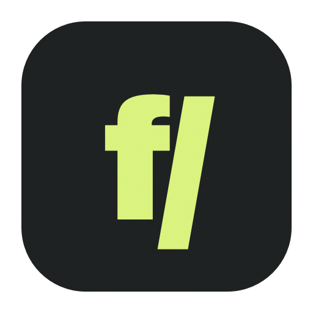

# F Distractions

Tell it what you are working on, start a focus session, and let it blur distracting screens so you can get back to your task.

This repository grew out of AI Tutor. The working product today is a native **macOS prototype**, internally named Gatekeeper. A Windows implementation is planned and belongs to its Windows contributor; no Windows app or framework has been scaffolded here.

## Start here

- **Mac build, usage and diagnostics:** [apps/mac/README.md](apps/mac/README.md)
- **What the product should do:** [docs/behaviour.md](docs/behaviour.md)
- **Why this structure:** [docs/architecture.md](docs/architecture.md)
- **Working together with Git, Codex and Claude:** [CONTRIBUTING.md](CONTRIBUTING.md)
- **Shared data formats, prompts and examples:** [shared/README.md](shared/README.md)

```text
apps/mac/          Existing SwiftUI/AppKit app, tests and packaging
shared/schemas/    Provider-independent AI response formats
shared/prompts/    Reference copies of the current Mac prompts
shared/fixtures/   Synthetic examples and behavioural acceptance scenarios
docs/              Product rules and architecture decisions
teacher/           Reserved for the separate, future tutor concept
AGENTS.md          Common instructions for coding assistants
CLAUDE.md          Loads the common instructions for Claude
```

The future Windows contributor can add `apps/windows/` when ready. Shared currently means common contracts and product behaviour, not a shared executable library. Both apps may initially implement the same rules in their own language.

## Mac quick start

Requires macOS 14+ and a Swift 6 toolchain. From the repo root:

```sh
cd apps/mac
swift build
swift test
```

Running the signed app also requires an Apple Development identity, Codex CLI with a ChatGPT sign-in, and Screen Recording permission. See the [Mac guide](apps/mac/README.md) for packaging and launch commands. The automated tests use fake AI connections and synthetic images; no login, live screenshot upload or signing certificate is needed for them.

## Product scope

Screenshots are assessed against a user-approved goal and task brief. Only clear off-task screen judgments can initiate blur. Blur stays locked until an explicit action or session lifecycle cleanup; merely switching a tab does not dismiss it. This is a focus aid, not an unbypassable OS lock. There is no webcam, phone detection, tutor implementation, hosted backend or telemetry.

Screenshots leave the machine for AI assessment through the configured provider. The Mac prototype currently uses a local Codex app-server and ChatGPT sign-in; your choice of coding assistant is independent of that integration. This repo contains source, not a signed public app release.
